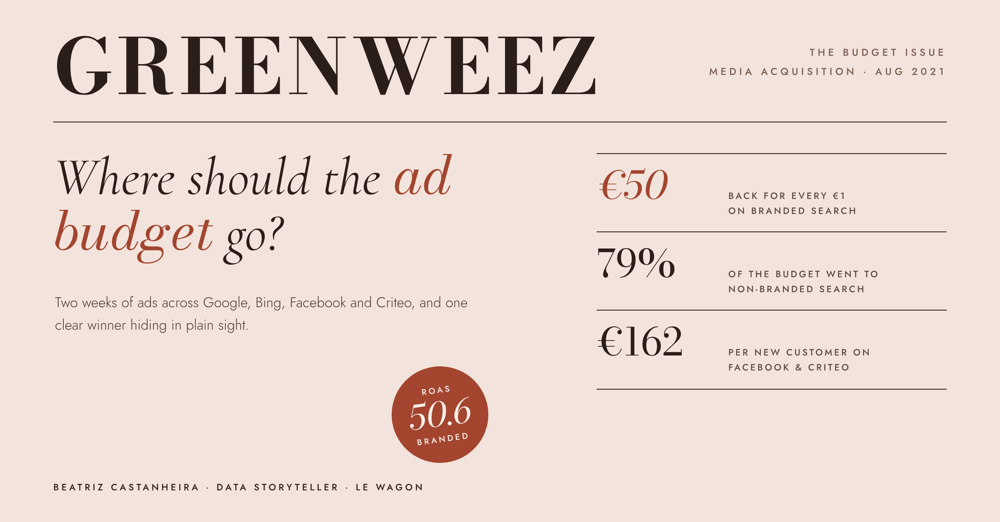

# Where should the ad budget go? Media acquisition analysis for Greenweez

*Every euro spent on ads is a small bet on who your next customer will be. This project follows those bets across Google, Bing, Facebook and Criteo, to see which ones actually paid off.*

**By Beatriz Castanheira** · Le Wagon Data Analytics Bootcamp, Barcelona 2026

**[Open the full analysis in Google Sheets](https://docs.google.com/spreadsheets/d/1lUsRJkuYhJLxLAHN5UUjcDp1cM1GJIiOF1ATM6FqI3c/edit?usp=sharing)**

## The question
Greenweez, an organic e-commerce brand, wanted to know which acquisition channels bring new customers at the best cost, and how to spend its advertising budget more wisely.

## What I did
- Joined order data with advertising data from **Google Ads, Bing, Facebook and Criteo** in one linked data model in Google Sheets
- Calculated **CTR, CPC, CPM, CAC and ROAS** for every channel with pivot tables
- Analysed two weeks of campaigns (1–15 August 2021): **€44,317** of ad spend across all paid channels

## Key numbers
| 50.6 | 79% | 13x | €162 |
|:---:|:---:|:---:|:---:|
| return on ad spend (ROAS) from branded search | of the ad budget went to non-branded search | cheaper new customers from branded vs. non-branded search | cost per new customer on Facebook, Criteo and other paid channels |

## Results by paid channel
| Channel group | Ad spend | Share of spend | New-customer orders | CAC | ROAS | CTR |
|---|---:|---:|---:|---:|---:|---:|
| SEA branded (Google, Bing) | €2,236 | 5% | 487 | €4.59 | **50.60** | 54.39% |
| SEA non-branded (Google, Bing) | €35,133 | 79% | 573 | €61.31 | 2.85 | 0.85% |
| Paid other (Facebook, Criteo…) | €6,948 | 16% | 43 | €161.58 | 1.21 | 0.71% |
| **All paid channels** | **€44,317** | **100%** | **1,103** | **€40.18** | **5.00** | **0.90%** |

*CAC = ad spend ÷ new-customer orders. ROAS = turnover ÷ ad spend. CTR = clicks ÷ impressions.*

## What I found
1. **Branded search is the star.** People already searching for Greenweez returned €50.60 for every €1 spent, at only €4.59 per new customer.
2. **Most of the budget went where returns were lowest.** Non-branded search took 79% of ad spend, for a ROAS of 2.85 and €61 per new customer.
3. **Social and display ads struggled.** Facebook, Criteo and other paid channels cost €162 per new customer and barely broke even (ROAS 1.21).

## What I'd recommend
- **Protect the branded search budget:** it is cheap and converts people who already know and like the brand
- **Review non-branded search campaign by campaign,** and move budget from the weakest to the strongest
- **Test smaller budgets and new creatives on Facebook and Criteo** before scaling them

## Tools
Google Sheets (linked data model, pivot tables, KPI calculations) · data storytelling
